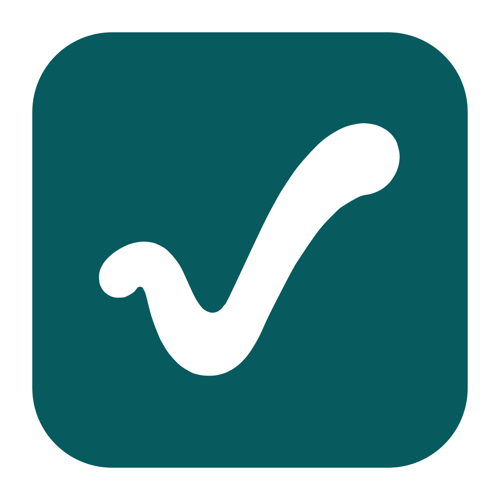

# Ultra Tasks



**A clearer everyday interface for tasks, planning, and time tracking.**

Ultra Tasks is an independent, UX-focused fork of [Super Productivity](https://github.com/super-productivity/super-productivity). It builds on that project's local-first task management, time tracking, integrations, and sync foundation, with a focus on making daily work easier to understand and faster to manage.

**Status: early development.** Ultra Tasks 0.1.0 is the first public desktop release, for Windows and macOS. Cross-client sync validation is still in progress. It is not an official Super Productivity release.

Maintained and published by **Adrian Chase**. The planned project website is [ultratasks.app](https://ultratasks.app); downloads and support are available through this GitHub repository while the website is being set up.

[UX priorities](#three-ux-priorities) · [Compatibility](#data-and-sync-compatibility) · [Build from source](#build-from-source) · [Give feedback](https://github.com/ac9492/ultra-tasks/issues)

## Why Ultra Tasks?

Super Productivity provides a capable foundation for focused individual work. Ultra Tasks explores how that foundation can feel more consistent: clearer dates and counts, predictable task entry, and navigation that helps you stay oriented.

The direction is practical: improve frequent interactions, keep the interface calm, preserve keyboard access, and keep the underlying data compatible with upstream. Small, testable improvements will guide the redesign.

## Already in this fork

| Area                      | Current changes                                                                                                                                                                          |
| ------------------------- | ---------------------------------------------------------------------------------------------------------------------------------------------------------------------------------------- |
| Dates at a glance         | Optional weekday labels for the next seven days, date-format choices such as `3-Dec` and `December 3rd`, and distinct colors for overdue, today, tomorrow, and upcoming scheduled dates. |
| Consistent task counts    | The Today sidebar and optional desktop app-icon badge share the due-task count, with a tooltip breakdown of overdue and today tasks.                                                     |
| Task organization         | Inline task creation within sections, bulk moves between sections, and completed/total subtask counts.                                                                                   |
| Separate desktop identity | Ultra Tasks has its own application identity, data folder, and desktop URL scheme, so it can be installed alongside Super Productivity.                                                  |

These additions sit on top of the inherited tasks, projects, tags, notes, planning, time-tracking, and integration features. Some changes may also exist in newer upstream versions.

The first workspace refresh adds restrained glass panels, a white checkmark on a deep-teal tile as the app identity, search at the top of navigation, clearer active navigation, a visible capture destination, and direct scheduling actions.

**Glass appearance** frosts the navigation and header over a slight, blurred view of the desktop (macOS and Windows 11 desktop app) or of your background image or palette gradient (web, mobile, Linux). It can be turned off under Settings → General → Appearance; the switch stays on the device, outside synced task data, and accessibility preferences can force solid panels.

## Three UX priorities

These remain ongoing design priorities. The first implementation addresses scanning, capture context, scheduling shortcuts, and active navigation; further changes will follow user feedback.

| Priority                               | Problem to address                                                                           | What improvement should achieve                                                                                                                                                 |
| -------------------------------------- | -------------------------------------------------------------------------------------------- | ------------------------------------------------------------------------------------------------------------------------------------------------------------------------------- |
| **1. Clearer task lists**              | Dates, status, progress, counts, and row actions compete for attention.                      | Make it easy to scan what needs attention and act on it, with consistent spacing and labels in light and dark themes. Build on the date and count improvements already present. |
| **2. Faster task capture and editing** | It can be difficult to tell where a new task will land or which date field to change.        | Make the destination project/section and the distinction between a scheduled date and a deadline obvious; keep common edits quick and keyboard-accessible.                      |
| **3. More predictable navigation**     | Switching between Today, Inbox, projects, and planning views can interrupt the flow of work. | Keep the current context visible and make frequent destinations easy to reach, while preserving access to advanced features.                                                    |

The [UX direction and research notes](docs/ultra-tasks-ux-direction.md) explain the evidence, initial prior art, and compatibility boundaries. Concrete designs will be prototyped and tested with users before implementation.

## Data and sync compatibility

**Upstream-compatible data and sync are a project requirement.** Ultra Tasks should not introduce a separate task-storage format, sync protocol, encryption scheme, or conflict-resolution model. Upstream migrations must continue to be followed. New display preferences should be device-local where possible and must not require fork-only fields in synced task records.

The fork inherits upstream's sync implementations, including Nextcloud/WebDAV, Dropbox, SuperSync, local-file sync on desktop, and OneDrive where supported. However, a complete provider-by-provider and mixed Ultra Tasks/Super Productivity test matrix has **not** yet been completed. Rebranded sign-in callbacks also need validation; inherited provider code alone is not a compatibility guarantee.

Keep a backup before trying development builds. The separate Ultra Tasks data folder does not automatically import an existing Super Productivity installation. See the [desktop build notes](docs/ultra-tasks-builds.md) and [inherited sync reference](docs/wiki/3.08-Sync-Integration-Comparison.md) for details and platform limitations.

## Downloads and release status

Download Ultra Tasks 0.1.0 from the [latest Ultra Tasks release](https://github.com/ac9492/ultra-tasks/releases/latest): a Setup installer or Portable app for Windows, and DMG or ZIP downloads for macOS on Apple Silicon (`arm64`) or Intel (`x64`), plus a universal DMG. `SHA256SUMS.txt` lists a checksum for every download. Upstream app-store links install Super Productivity.

Windows builds are unsigned, so SmartScreen may ask for confirmation. Mac builds are ad-hoc signed and are not Apple-notarized; macOS may require approval under System Settings → Privacy & Security. There are no Linux, mobile, or app-store builds, and the app does not update itself: the optional update check only tells you when a newer release is available.

## Build from source

Use the Node.js and package-manager versions declared in [package.json](package.json).

```sh
git clone https://github.com/ac9492/ultra-tasks.git
cd ultra-tasks
npm ci
npm run startFrontend
```

For desktop packaging, follow the [Ultra Tasks build instructions](docs/ultra-tasks-builds.md). The inherited [repository map](docs/repository-map.md) explains the codebase and focused checks.

## Help shape Ultra Tasks

Ultra Tasks is maintained and published by **Adrian Chase** ([@ac9492](https://github.com/ac9492)). General questions, bug reports, and ideas belong in this repository; private vulnerability reports go through the [security policy](SECURITY.md).

Designers, accessibility reviewers, testers, documentation contributors, and developers are welcome.

- [Report an issue or suggest an improvement](https://github.com/ac9492/ultra-tasks/issues/new). Describe the task you were trying to do, what happened, and the outcome you expected.
- Share a small mockup or a reproducible example for one of the three UX priorities. Please use sample tasks and remove personal information from screenshots and logs.
- Test keyboard navigation, light/dark themes, long task lists, installation, and the sync service you actually use. Include the platform and build version in feedback.
- Discuss substantial interface changes before opening a large pull request. The [feature review guide](docs/feature-review-guide.md) covers prior art, scope, and long-term compatibility costs.

Please bring fork-specific support and feedback to this repository. We aim to contribute generally useful fixes upstream and keep the relationship constructive.

## Credits and license

Ultra Tasks is based on Super Productivity, created by Johannes Millan and its contributors. Their work provides the foundation for this fork. Ultra Tasks is independently maintained and is not affiliated with or endorsed by the upstream project.

The client application and most shared packages retain the [MIT license](LICENSE) and original upstream copyright notices. The Ultra Tasks distribution of the [SuperSync server](packages/super-sync-server/) is licensed under [AGPL-3.0-only](packages/super-sync-server/LICENSE), while preserving the original upstream MIT rights and notices. See [LICENSING.md](LICENSING.md) for scope, compatibility, and contributor guidance; third-party components retain their respective licenses.
